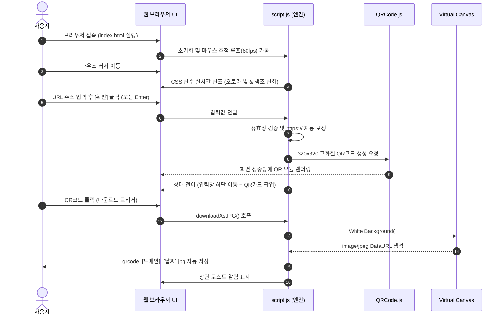

# 워크스루 가이드 (Walkthrough)

본 문서는 사용자가 웹사이트에 접속하여 QR코드를 생성하고 JPG 파일로 저장하기까지의 전체 여정과 내부 동작 원리를 단계별로 설명합니다.

---

## 1. 전체 실행 흐름도

---

## 2. 단계별 상세 워크스루

### Step 1: 최초 접속 및 인터랙티브 배경 반응
1. `D:\프로젝트04\index.html` 파일을 더블 클릭하여 브라우저에서 실행합니다.
2. 상단 좌측에는 선명한 로고(`img/logo.png`)가 배치되어 있으며, 화면 정중앙에는 심플하고 세련된 URL 입력창이 나타납니다.
3. **마우스 커서를 움직여 보세요**:
   - 마우스 커서의 뒤를 부드럽게 따라다니는 따뜻한 빛의 아우라(`cursor-glow`)를 확인할 수 있습니다.
   - 마우스를 좌/우, 상/하로 움직일 때마다 배경의 오로라 색상이 따뜻한 피치 코랄에서 화사한 골든 앰버로 실시간 변화합니다.

---

### Step 2: URL 입력 및 스마트 자동 보정
1. 중앙 입력 필드를 클릭하고 변환하고자 하는 웹사이트 주소를 입력합니다.
2. 입력창 우측에 텍스트를 한 번에 비울 수 있는 `✕` 지우기 버튼이 나타납니다.
3. `https://`를 직접 쓰지 않고 `naver.com`, `daum.net`, `google.com` 등 도메인만 입력해도 됩니다.
   - 내부 스크립트가 스마트하게 이를 감지하여 `https://naver.com` 형태로 자동 완성합니다.
4. 만약 아무것도 입력하지 않고 확인을 누르면, 입력창이 좌우로 흔들리는 진동(Shake) 피드백과 함께 빨간색 경고 문구가 출력됩니다.

---

### Step 3: 확인 액션 및 화면 레이아웃 전환
1. 주소 입력 후 키보드의 `Enter` 키를 누르거나, 황금빛 [확인] 버튼을 클릭합니다.
2. **부드러운 레이아웃 전환**:
   - 중앙에 있던 입력창이 아래로 미끄러져 내려가 화면 하단에 플로팅 독(Floating Dock) 형태로 정착합니다.
   - 화면 정중앙에 부드러운 스케일 업 애니메이션과 함께 고화질 QR코드 카드가 등장합니다.
3. 하단에 정착된 입력창은 그대로 유지되므로, 언제든지 다른 URL을 입력하여 즉시 새 QR코드로 갱신할 수 있습니다.

---

### Step 4: 1클릭 JPG 파일 다운로드
1. 정중앙에 생성된 **QR코드 카드를 직접 클릭**합니다. (카드 내부의 'JPG 파일 다운로드' 버튼을 눌러도 동일하게 동작합니다.)
2. 클릭 즉시 브라우저 다운로드 폴더에 고화질 `.jpg` 파일이 저장됩니다.
   - **파일명 규칙**: `qrcode_[도메인명]_[생성일자].jpg` (예: `qrcode_naver_com_20261020.jpg`)
   - **화질 및 배경**: 사방 40px의 깨끗한 화이트 안전 여백과 순백색 배경이 적용되어 모바일 카메라 스캔 및 인쇄 시 최고의 인식률을 보장합니다.
3. 화면 상단에 "JPG 파일이 성공적으로 다운로드되었습니다!" 안내 토스트 팝업이 부드럽게 나타났다가 사라집니다.

---

### Step 5: 처음으로 초기화
* 상단 좌측의 **로고**를 클릭하거나 우측 상단의 **[새로 만들기]** 버튼을 클릭하면, 모든 상태가 초기화되어 첫 화면(중앙 입력창)으로 즉시 복귀합니다.
